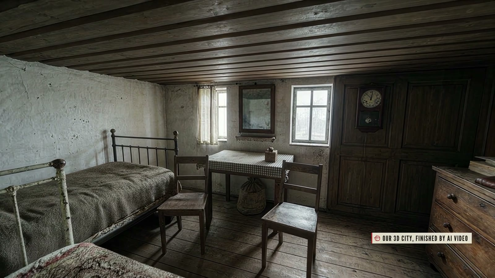

# Berlin, Winter 1917

[](https://media.raea.io/#berlin-1917)

**[Watch the film](https://media.raea.io/#berlin-1917)** (9:32, 1920×1080, 24 fps, with sound)

On 18 October 1917, a photographer from Berlin's health insurance fund, the Ortskrankenkasse, climbed an iron spiral
stair in the side wing of Ritterstraße 120. At the top were two low rooms over a horse stable, where a sick woman of
sixty-seven lived with her husband. The fund photographed the room and printed what it found under the picture: the
room is 3.90 metres long, 3 metres wide and 1.80 metres high, and she had lived in that porter's flat for fifteen
years.

This documentary is built on that one photograph and one question: could we stand in that room? To answer it, the
film rebuilds the city around the room from the record. Straube's plan of 1910 gives the houses, the 1917 address
book gives the neighbours, the fund's own photographs of 127 rooms furnish them, and James Hobrecht's sewer atlas of
1884 gives the pipes underneath. The film is about the record and what it lets us rebuild; every fact in it comes
from a source, and `docs/narration.md` gives the source of each line.

It was made in [raea](https://raea.io). This folder is the film's source: the compositions that cut it and made its
shots, the 3D city's code, the rooms and the sewers, the narration, the prompts and scripts behind the AI-finished
shots, and the research the facts come from. It's Apache-2.0, so read it, check it against the record, and reuse
any of it.

## How it was made

1. **The photograph first.** The film starts from plate z2_1917_MP_0075 of the fund's survey, held by the Zentral- und
   Landesbibliothek Berlin, and its caption. `research/rooms.tsv` holds every surveyed room's caption and
   measurements, and `research/survey-tally.tsv` counts what the photographs show (beds in kitchens, lace curtains).
2. **The map.** Straube's 1910 plan of Berlin at 1:4,000 was read into buildings by a small neural network, trained on
   twelve tiles and tested on three it had never seen. The layers and their sources are listed in
   [`map/SOURCES.md`](map/SOURCES.md), and [`research/replicate.md`](research/replicate.md) says how each was made.
   The plan is nearly a picture of 1917, because Berlin all but stopped building during the war.
3. **The city.** The houses, shops, streets, people and trees are built in code from those layers
   (`components/world`, `components/people`, `components/foliage`, `tools/city`). Each house is planned as the
   tenement type Hobrecht's plan produced: a front building, side wings and rear buildings around courtyards.
4. **The rooms.** For each of the fund's photographs, the walls were built to the caption's measurements and the
   furniture traced from the photograph wall by wall (`interiors/`). The porter's flat is
   [`interiors/sets/porter.ts`](interiors/sets/porter.ts). Rooms the fund never photographed, such as the salons, are
   reasoned rather than seen, and the film says so whenever you're in one.
5. **The neighbours.** The 1917 address book is printed in Fraktur. Claude read it one column at a time
   ([`tools/addr/transcribe.ts`](tools/addr/transcribe.ts)), and its entries became the houses' shops and owners.
   Residents' names are never put on characters.
6. **Under the street.** One system of Hobrecht's 1884 sewer atlas, the one under this part of the city, was traced
   by hand: 56.4 km, mostly clay pipe, with the big sewers in brick and shaped like an egg, all running down to the pumping station at Hallesches Ufer
   (`components/underground`).
7. **The shots.** Each shot is a raea render of that city (`compositions/rebuilt-v*-*.tsx`). Most were then finished
   by AI video: a Nano Banana 2 keyframe of the render's first frame, Kling O3 Pro Edit over the render, and Topaz
   Starlight Precise 2.6 to restore 1080p detail. The film marks each one: "Our 3D city, finished by AI video" for
   these, and "Our 3D model, built from the record" for the bare renders. The bare 3D render of every AI-finished
   shot is in the download too, in `assets/rebuilt/bare` and `assets/rebuilt/shots5/bare`, under the same name as its
   finished shot, so anyone can compare our render with the finish. The prompts are in `docs/kling/` and
   [`docs/shots.md`](docs/shots.md) lists every shot and the line it's for. [`tools/clipgate.py`](tools/clipgate.py)
   checks every clip against the master (size, frame rate, real 1080p detail) before it goes in.
8. **The narration.** [`docs/narration.md`](docs/narration.md) is the script in five chapters, one question each,
   written after studying how eight documentaries are written
   ([`docs/how-docs-are-written.md`](docs/how-docs-are-written.md)). Fish Audio read it ([`tools/vo4.py`](tools/vo4.py)),
   and [`tools/timeline4.py`](tools/timeline4.py) laid the paragraphs out in film time.
9. **The records canvas.** Between chapters the camera travels over one desk of every record the film uses
   ([`components/rebuilt/record-canvas.tsx`](components/rebuilt/record-canvas.tsx);
   [`docs/records-graph.md`](docs/records-graph.md) is its plan).
10. **The cut.** [`compositions/berlin-rebuilt-v5.tsx`](compositions/berlin-rebuilt-v5.tsx) is the whole film: the
    shots, the records, the narration and the music on one clock, mixed to −14 LUFS.

## Make it yourself

You need [raea](https://raea.io) 0.1.8 or later, ffmpeg and zstd. It was rendered on an Apple silicon Mac.

The media comes with a raea account, which is free: sign in on [the film's page](https://media.raea.io/#berlin-1917),
press **Get the media**, and it gives you the `tools/get-assets.sh` line below with your own link (or the archive to
download, which `tools/get-assets.sh` takes as a path).

```sh
git clone https://github.com/shinyobjectz/raea-films && cd raea-films/berlin-1917
tools/get-assets.sh LINK   # everything: the shots and their bare renders, the narration, the records, the 3D city and
                           # the 1917 map layers; 5.2 GB, 9.2 GB unpacked

# one frame of the film: the iron spiral stair up to the porter's flat
raea render compositions/berlin-rebuilt-v5.tsx --composition berlin-rebuilt-v5 --frame 1440 -o stair.png

# the photograph itself, with its caption, on the records desk
raea render compositions/rebuilt-labels-board.tsx --composition labels-desk --frame 0 -o plate.png

# the porter's flat built in code from the caption, before the AI finish
raea render compositions/rebuilt-v5-build.tsx --composition build-final --frame 48 -o room.png

# the 1917 city: the 07:15 bread queue at a side-street bakery, and a kitchen in a side wing
raea render compositions/rebuilt-v5-city.tsx --composition s5-queue --frame 48 -o queue.png
raea render compositions/rebuilt-v5-rooms.tsx --composition s5-kitchen-room --frame 48 -o kitchen.png

# the whole film, then its checks
tools/film5.sh
```

The song isn't in the download, so the film renders with the narration alone unless you put a score of your own at
`assets/rebuilt/stems/score-v4.wav`; [`ASSETS.md`](ASSETS.md) says how. Every composition in `compositions/`
renders from this folder and its download, the shot compositions included: the download carries the 3D city they
render from (its streamed tiles, the houses and their rooms, the graybox, the props, the trees, the people's places
and the skies) and the 1917 map layers it was built from, in `map/1917/`.

The tools that made that data are here too: `tools/map/` read the Straube plan and built the map layers,
`tools/world/` baked the city's tiles, props, trees and smoke from them, `tools/foliage/` set each tree's species,
`tools/signs/` drew the shop signs' font atlas, `tools/people/` placed the people, and `tools/addr/` read the address
book. Two kinds of raw input they started from aren't in the download: the Geoportal Berlin and OpenHistoricalMap downloads
(fetch them again from the services `map/SOURCES.md` lists) and the address book's page scans (from the ZLB). The tool that baked the rooms into the city's houses also bakes sets this film doesn't
use, so it isn't here; its output is in the download.

The scripts in `tools/` are the ones that made the film: `kling*.sh` and `fal_run.py` sent the AI-video jobs (they
need your own fal key in `FAL_KEY` and cost money to run), `upres1.sh` restored the clips, and `arrange4.py` cut the
song to the chapters.

## Layout

| | |
|---|---|
| `compositions/` | what renders: `berlin-rebuilt-v5.tsx` (the film), `rebuilt-v5-canvas.tsx` and `rebuilt-labels-board.tsx` (the records canvas and the labels), and the compositions that made the shots |
| `components/` | what the compositions import: the city, the people, the trees, the sewers, the records canvas |
| `interiors/` | the rooms: the kit of period things, the planner, and the sets built from the fund's photographs |
| `world/`, `people/`, `tools/city/` | the city's budgets and streaming, the people of 1917, and the city's build tools |
| `map/1917/` | the 1917 map layers (fetched by `tools/get-assets.sh`); `map/SOURCES.md` says what each layer is and where it came from |
| `research/`, `map/SOURCES.md` | the surveyed rooms, the tally of what they show, the catalogue of period things, and the map's sources |
| `docs/` | the narration with its sources, the shot list, the AI-video prompts and the canvas plan |
| `tools/` | the scripts that made the narration, the shots, the score and the film |
| `assets/` | fetched by `tools/get-assets.sh`: the shots, the narration, the records and the 3D city |
| `brief.ts` | the brief |

## Licence

The code and every asset made for this film are licensed under the [Apache License 2.0](../LICENSE). The records
are public domain (the Ortskrankenkasse's photographs, the 1917 address book and Hobrecht's atlas) or released under
the Data licence Germany – Zero (Straube's plan and the Geoportal Berlin's layers). OpenHistoricalMap's data and the
Poly Haven texture scans are CC0. The fonts are under the SIL Open Font License. [`ASSETS.md`](ASSETS.md) lists each one, and [`CREDITS.md`](CREDITS.md) credits them.

The song, *Count You Too*, isn't ours to pass on and isn't in the download.

The raea name and logo are trademarks and aren't covered by the Apache licence.
