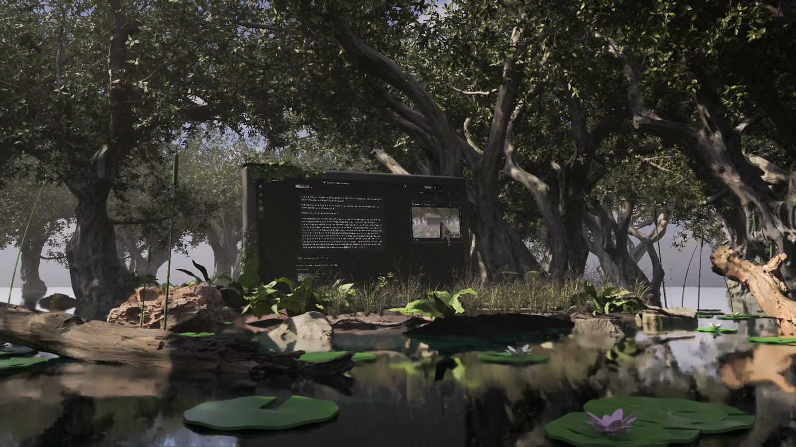

# Mothership

[](https://media.raea.io/#swamp)

**[Watch the film](https://media.raea.io/#swamp)** (85 s, 1920×1080, 30 fps, with sound)

A small robot cursor, on a giant monitor sunk in a dead grey swamp, redesigns the world it's standing in: the sun comes
up, the water turns, the leaves come back. Then it sends the film up to the mothership for review, where the aliens
watch it, cheer, and leave one note: *"I'm not sure this is on brand for us."*

It's the launch film for [raea](https://raea.io) 0.1.5, made in raea. Every shot is code: React and TypeScript
compositions that raea renders on the GPU with ray-traced light. This folder is the whole project: the
compositions, the scripts that made its assets and its sound, the brief, the shot-by-shot script, and the production
log from the first grey boxes to the fifth cut. It's Apache-2.0, so read it, take it apart, reuse any of it, and make
your own.

## How it was made

1. **A brief and a script before any picture.** [`brief.ts`](brief.ts) says what the film is for, who it's for, and
   what it won't do (no narrator, no titles, no generated images or video). [`hype.script.ts`](hype.script.ts)
   describes every shot: what's on screen, what you hear, and how long it lasts.
2. **Grey boxes first.** `compositions/previz*.tsx` blocked out the whole film's cameras and timing in grey before
   anything was modelled. From there on, one timeline ([`components/timeline.ts`](components/timeline.ts)) holds the
   frame of every event: a key press, the sun's slider, the beam firing. The picture and the sound both read it, so
   every sound lands on its frame. [`components/cut.ts`](components/cut.ts) is the edit.
3. **A real swamp.** The trees, roots, rocks, moss and plants are photo-scanned models from Poly Haven, placed by
   [`components/world.tsx`](components/world.tsx) and lit by ray tracing (raea's Solari) under real HDRI skies. The
   ivy that climbs the monitor is grown by [`scripts/make_ivy.py`](scripts/make_ivy.py) from scanned leaves. The
   keyboard, the monitor and the robot are built in code ([`components/set.tsx`](components/set.tsx),
   [`components/robot.tsx`](components/robot.tsx)), and the keyboard's grime is procedural
   ([`scripts/make_grime.py`](scripts/make_grime.py)).
4. **The real app on the screen.** What the monitor shows is the raea app itself, driven against a mock API and agent
   (`assets/app-take/fixture`), captured one state at a time ([`scripts/app_states.py`](scripts/app_states.py)), and
   played back under the robot's moves ([`components/take.ts`](components/take.ts)).
5. **Up to orbit.** The Earth is built from NASA's Blue Marble and Black Marble maps
   ([`scripts/earth_maps.py`](scripts/earth_maps.py), [`components/earth.tsx`](components/earth.tsx)) under an
   atmosphere that scatters the sun. The stars are NASA's Deep Star Maps. The mothership is a raea solid
   ([`solids/mothership.ts`](solids/mothership.ts)) fitted out in Blender
   ([`blender/mothership.py`](blender/mothership.py)).
6. **The aliens.** Their hands have skin made by [`scripts/make_skin.py`](scripts/make_skin.py) and type finger by
   finger ([`components/room.tsx`](components/room.tsx)). Their script's glyphs and the screen they watch come from
   [`scripts/room_screen.py`](scripts/room_screen.py). Their voices are a language of their own, cut syllable by
   syllable from recorded speech and calls, re-sequenced, deepened and doubled
   ([`scripts/alien_voice_v3.py`](scripts/alien_voice_v3.py)).
7. **Sound.** The swamp's beds and every action's foley are CC0 recordings from freesound.org, cut and placed by the
   `scripts/sfx_*.py` scripts. The score is written in code and played on sampled instruments
   ([`scripts/score_v5.py`](scripts/score_v5.py): the Salamander grand piano, and VSCO-2's strings, horn, harp and
   timpani). [`compositions/hype-sound-v5.tsx`](compositions/hype-sound-v5.tsx) mixes it all to −14 LUFS.
8. **Render.** Each of the 39 shots renders to PNG frames, is encoded with x264, and the shots are joined with the mix
   under them ([`scripts/render_film_v5.sh`](scripts/render_film_v5.sh)).

[`plan.org`](plan.org) is the production log: every task, every note on every cut from v1 to v5, and what was done
about it. [`review/NOTES.md`](review/NOTES.md) lists the gaps in raea we hit while making it, and how each was worked
around.

## Make it yourself

You need [raea](https://raea.io) 0.1.6 or later, ffmpeg, zstd and zsh. It was rendered on an Apple silicon Mac; the
light is ray traced, so it needs a GPU raea can ray trace on.

The media comes with a raea account, which is free: sign in on [the film's page](https://media.raea.io/#swamp),
press **Get the media**, and it gives you the `tools/get-assets.sh` line below with your own link (or the archive to
download, which `tools/get-assets.sh` takes as a path).

```sh
git clone https://github.com/shinyobjectz/raea-films && cd raea-films/swamp
tools/get-assets.sh LINK # the scans, skies, recordings, instruments and plates: 1.3 GB, 1.8 GB unpacked

# one frame of one shot (the 39 shots are compositions s01-water ... s32-end in compositions/hype.tsx)
raea render compositions/hype.tsx --composition s11-sun --frame 30 -o sun.png

# the sound, then the whole film, shot by shot
raea render compositions/hype-sound-v5.tsx --composition sound -o out/v5/sound/hype-v5-mix.wav
FILM=out/film-v5 scripts/render_film_v5.sh out/swamp.mp4
```

The Python scripts under `scripts/` made the assets (they're already in the download), so you only need them to
change something: they use numpy, scipy, soundfile, Pillow and mido. `blender/mothership.py` runs in Blender.
Earlier cuts' compositions (`*-v2`, `-v3`, `-v4`) and `scripts/sound.sh` are kept as history; the generated sounds
they used were replaced by recordings in v2 and aren't in the download.

## Layout

| | |
|---|---|
| `compositions/` | what renders: `hype.tsx` (the picture, one composition per shot), `hype-sound-v5.tsx` (the sound), and the previz and earlier cuts |
| `components/` | everything the compositions import: the world, the set, the robot, the room, space, the timeline and the cut |
| `scripts/` | the scripts that fetched and made the assets, the score and the effects, and rendered the film |
| `solids/`, `blender/` | the mothership |
| `assets/` | fetched by `tools/get-assets.sh` |
| `brief.ts`, `hype.script.ts` | the brief and the shot-by-shot script |
| `plan.org`, `review/NOTES.md` | the production log, and raea's gaps hit on the way |

## Licence

The code and every asset made for this film are licensed under the [Apache License 2.0](../LICENSE). The assets made by
others keep their own licences, and [`ASSETS.md`](ASSETS.md) lists each one:

- **CC0** (public domain dedication, free for any use): the Poly Haven scans, skies and textures, the ambientCG
  textures, every freesound.org recording, the VSCO-2 instruments and the Khronos Barramundi fish.
- **CC BY**, so keep the credit wherever you use them: *Flying Raven* by Google Data Arts Team (CC BY 3.0), the
  *Salamander Grand Piano* by Alexander Holm (CC BY 3.0), and the Egyptian goose skull scan by the Musée national
  d'histoire naturelle Luxembourg (CC BY 4.0).
- **Public domain**: NASA's Earth and star maps.

The raea name and logo (`assets/brand/`) are trademarks and aren't covered by the Apache licence. Put your own mark
in their place in anything you make from this.
